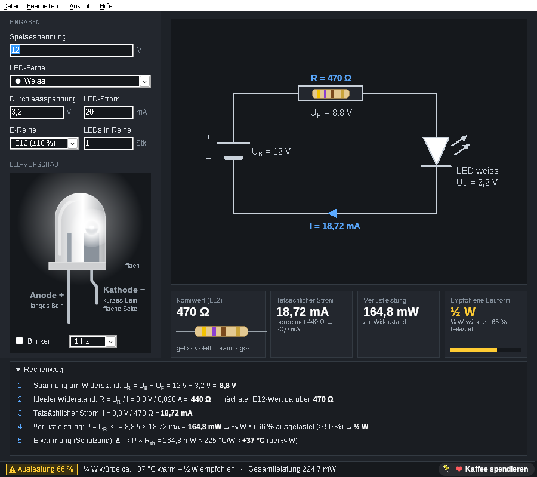

# Elospeed LedPreResistor 2.0

**von Elospeed**

🇬🇧 **English version:** [README.md](README.md)

**Webseite:** [elospeed.github.io/LedPreResistor/de](https://elospeed.github.io/LedPreResistor/de/) · **Download:** [neuestes Release](https://github.com/Elospeed/LedPreResistor/releases/latest)



LedPreResistor berechnet den Vorwiderstand für eine oder mehrere LEDs. Es ist die Neuauflage der Freeware *LED Pre-Resistor* (Delphi 7, 2004), komplett neu gebaut in Lazarus: eine einzelne 64-Bit-Windows-EXE, ohne Installation, ohne Zusatzpakete.

**Was es kann**

- **Live-Berechnung** beim Tippen: Betriebsspannung, Durchlassspannung, LED-Strom und Anzahl LEDs in Reihe.
- **Nächster Normwert** aus E12, E24 oder E96 (immer der nächsthöhere, damit die LED nie mehr Strom bekommt als geplant).
- **Tatsächlicher Strom und Leistung** im Widerstand, in den LEDs und gesamt, dazu die empfohlene Belastbarkeit (⅛ / ¼ / ½ / 1 W) mit Warnung ab 50 % Auslastung und geschätzter Erwärmung.
- **Farbringe** des Widerstands (4 Ringe, bei E96 5 Ringe) und ein **Schaltplan** mit allen Werten an den Bauteilen.
- Aufklappbarer Bereich **«Rechenweg»**: zeigt die Rechnung Schritt für Schritt mit den eigenen Zahlen.
- Vorgaben für rote, gelbe, grüne, blaue, weisse und Infrarot-LEDs oder eigene Durchlassspannung aus dem Datenblatt.
- **LED-Vorschau**: eine 5-mm-LED in der gewählten Farbe, Anode, Kathode und flache Seite beschriftet, auf Wunsch blinkend.
- **LED-Info** «Die Leuchtdiode» eingebaut (F1, öffnet sich im Browser, auch offline).
- Resultat kopieren mit Strg+Umschalt+C. Komma und Punkt als Dezimalzeichen.
- Das Programm ist vorerst auf Deutsch; eine englische Übersetzung ist geplant.

**Beispiel:** 12 V, eine weisse LED (3,2 V), 20 mA → berechnet 440 Ω, **470 Ω** (E12, gelb-violett-braun-gold), tatsächlich 18,72 mA, 164,8 mW im Widerstand → ½-W-Widerstand nehmen.

LedPreResistor ist ein Ein-Personen-Hobbyprojekt. Wenn es dir hilft, kannst du mir auf [Ko-fi](https://ko-fi.com/elospeed) einen Kaffee spendieren ☕. Ganz freiwillig, das Tool bleibt so oder so kostenlos. Das Programm fragt nie; unten in der Statuszeile gibt es nur einen kleinen Knopf «Kaffee spendieren».

## Loslegen

1. Das ZIP vom [neuesten Release](https://github.com/Elospeed/LedPreResistor/releases/latest) herunterladen und irgendwo entpacken.
2. `LedPreResistor.exe` starten. Nichts zu installieren. Windows SmartScreen warnt evtl., weil die EXE nicht signiert ist: «Weitere Informationen» → «Trotzdem ausführen».
3. Optional: Prüfsumme mit der in den Release-Notizen vergleichen (`certutil -hashfile LedPreResistor.exe SHA256`).

## Bauen

Lazarus 3.8 (FPC 3.2.2), nur LCL:

```
lazbuild -B --os=win64 --cpu=x86_64 --ws=win32 src/LedPreResistor.lpi
```

Jeder Pull Request und jeder Push auf `main` wird von GitHub Actions automatisch gebaut (`.github/workflows/build.yml`).

## Aufbau des Repositorys

| Pfad | Inhalt |
|---|---|
| `src/` | Lazarus-Projekt und Units |
| `src/lang/` | Übersetzungen (Deutsch / Englisch) |
| `tests/` | Tests der Rechenlogik (FPCUnit, laufen bei jedem Build mit) |
| `docs/PROJEKTUEBERSICHT.md` | Verbindliche Spezifikation: Funktionen, Berechnung, Design, Units |
| `docs/ENTWICKLUNGSLOG.md` | Fehler, Lehren, Stolperfallen |
| `docs/IDEEN.md` | Ideen, noch nicht eingeplant |
| `docs/TESTVERSIONEN.md` | Wo die Testversionen liegen und wie man testet |
| `docs/legacy/` | Originaler Delphi-7-Quellcode von 2004, nur als Referenz |
| `docs/design/` | Gewählter Entwurf (HTML-Datei im Browser öffnen) |
| `site/` | Projektseite (GitHub Pages, Englisch und Deutsch) |

## Lizenz

MIT, siehe [LICENSE](LICENSE).
